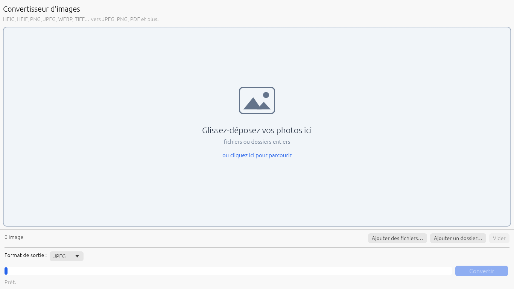
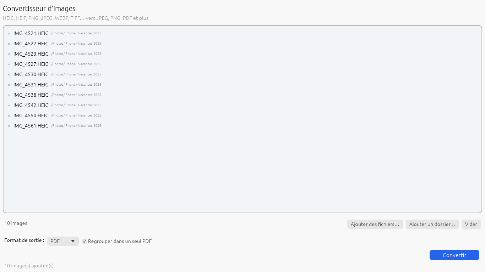

<p align="center">
  
</p>

<h1 align="center">HeicDrop</h1>

<p align="center">
  Convertissez vos photos <b>HEIC</b> d'iPhone (et presque toutes les images) en <b>JPEG, PNG, PDF</b>… par simple glisser-déposer.<br>
  Application Windows gratuite, légère et open source (MIT).
</p>

<p align="center">
  
  
</p>

## Fonctionnalités

- **Glisser-déposer** de fichiers isolés, d'une sélection multiple ou de dossiers entiers (sous-dossiers inclus).
- **Conversion en lot**, en parallèle sur tous les cœurs du processeur, avec barre de progression et bouton *Annuler*.
- **Formats d'entrée** : HEIC, HEIF, HIF, JPEG, PNG, WEBP, TIFF, BMP, GIF, ICO, TGA, PNM, QOI, DDS, HDR.
- **Formats de sortie** : JPEG, PNG, PDF (une page par image ou **un seul PDF regroupé**), WEBP, TIFF, BMP, GIF.
- Les photos sont **redressées automatiquement** (orientation EXIF) et les **métadonnées** (date de prise de vue, appareil, GPS…) ainsi que le profil couleur sont conservés en JPEG, PNG et WEBP.
- La transparence est conservée quand le format le permet (PNG, WEBP, TIFF, GIF) et remplacée par du blanc sinon.
- **Aucun fichier n'est écrasé** : en cas de doublon, `photo (1).jpg`, `photo (2).jpg`…
- Les images d'origine ne sont jamais modifiées.
- 100 % hors ligne : aucune donnée n'est envoyée sur Internet.

## Télécharger

- **Microsoft Store** : https://apps.microsoft.com/detail/9NZTB7VCGFGH *(actif une fois l'application certifiée)*
- **Version portable** : page [Releases](../../releases) → `HeicDrop-x.y.z-windows-x64.zip`, à décompresser puis lancer `HeicDrop.exe` (aucune installation).

Configuration requise : Windows 10 (1809) ou Windows 11, 64 bits.

📖 **[Guide utilisateur](docs/GUIDE_UTILISATEUR.md)**

## Compiler depuis les sources

### Windows

1. Installer [Rust](https://rustup.rs) (chaîne MSVC) et Visual Studio Build Tools (C++).
2. Installer libheif avec [vcpkg](https://vcpkg.io) :
   ```powershell
   git clone https://github.com/microsoft/vcpkg C:\vcpkg
   C:\vcpkg\bootstrap-vcpkg.bat
   C:\vcpkg\vcpkg install "libheif[core,libde265]:x64-windows"
   ```
3. Compiler :
   ```powershell
   $env:VCPKG_ROOT = "C:\vcpkg"; $env:VCPKGRS_DYNAMIC = "1"; $env:VCPKGRS_TRIPLET = "x64-windows"
   $env:PATH += ";C:\vcpkg\installed\x64-windows\bin"
   cargo test --release
   cargo build --release
   ```
   L'exécutable est `target\release\heicdrop.exe` ; il a besoin des DLL de `C:\vcpkg\installed\x64-windows\bin` à côté de lui.

### Linux (développement)

```bash
sudo apt install libheif-dev libheif-plugin-libde265 libgtk-3-dev libxkbcommon-x11-0
cargo run --release
```

## Paquet Microsoft Store (MSIX)

Le workflow GitHub Actions [`build.yml`](.github/workflows/build.yml) produit à chaque tag `v*` :
- l'archive portable `.zip`,
- le paquet `.msix` prêt à être téléversé dans l'Espace partenaires.

Toute la procédure est décrite dans **[docs/store/SOUMISSION_MICROSOFT_STORE.md](docs/store/SOUMISSION_MICROSOFT_STORE.md)**.

## Structure du projet

```
src/main.rs                  Interface (egui) : zone de dépôt, liste, format, conversion
src/converter.rs             Lecture (libheif / image), écriture, PDF, traitement en lot + tests
assets/                      Icônes de l'application
packaging/msix/              Manifeste MSIX et visuels du Store
packaging/build-msix.ps1     Construction du paquet MSIX
tools/generate_icons.py      Régénère toutes les icônes
docs/                        Guide utilisateur, captures, dossier Microsoft Store
```

## Licence

[MIT](LICENSE). Les bibliothèques tierces conservent leur propre licence : voir [THIRD_PARTY_NOTICES.md](THIRD_PARTY_NOTICES.md)
(libheif et libde265 sont sous LGPL et livrées en DLL remplaçables).
