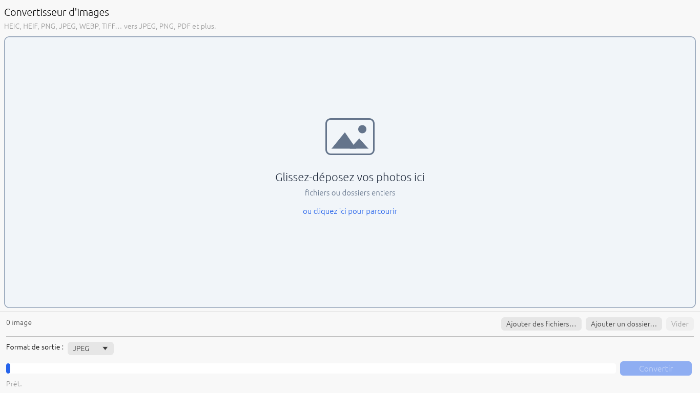
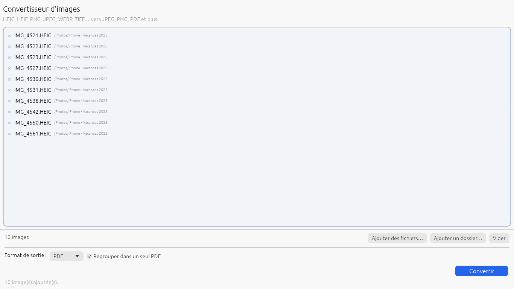

# Guide utilisateur — HeicDrop

HeicDrop transforme vos photos d'iPhone (fichiers **.HEIC**) et la plupart des autres images en formats que tout le monde peut ouvrir : **JPEG**, **PNG**, **PDF**, etc.

Vos photos d'origine **ne sont jamais modifiées** : HeicDrop crée des copies converties dans le dossier de votre choix.

---

## En 3 étapes

### 1. Ajoutez vos photos

Au choix :

- **Glissez-déposez** vos photos dans le grand cadre (une seule, plusieurs, ou un dossier entier) ;
- **cliquez dans le cadre** ou sur **Ajouter des fichiers…** pour les choisir ;
- cliquez sur **Ajouter un dossier…** pour prendre toutes les images d'un dossier (et de ses sous-dossiers).

Vous pouvez ajouter des photos plusieurs fois de suite : elles s'ajoutent à la liste, sans doublon.

> Une photo ajoutée par erreur ? Cliquez sur le petit **×** devant son nom. Le bouton **Vider** retire tout.

### 2. Choisissez le format de sortie

Dans **Format de sortie**, choisissez :

| Format | Quand l'utiliser |
|---|---|
| **JPEG** *(recommandé)* | Pour partager, envoyer par courriel, publier. Fichiers légers, compatibles partout. |
| **PNG** | Qualité parfaite, conserve la transparence. Fichiers plus lourds. |
| **PDF** | Pour imprimer ou envoyer des documents (reçus, pièces justificatives…). |
| **WEBP** | Pour un site web. Qualité parfaite. |
| **TIFF** | Pour l'impression professionnelle ou l'archivage. |
| **BMP** / **GIF** | Pour d'anciens logiciels qui n'acceptent que ces formats. |

**Option PDF :** cochez **Regrouper dans un seul PDF** pour obtenir **un seul document** contenant toutes les photos (une par page, dans l'ordre de la liste), nommé `images_converties.pdf`. Sinon, chaque photo devient son propre PDF.

### 3. Cliquez sur « Convertir »

1. Une fenêtre vous demande **où enregistrer** les images converties : choisissez (ou créez) un dossier, puis validez.
2. La barre de progression avance. Vous pouvez cliquer sur **Annuler** à tout moment.
3. À la fin, un résumé s'affiche. Cliquez sur **Ouvrir le dossier** pour voir vos images.

Les photos converties avec succès disparaissent de la liste ; celles en erreur restent, pour que vous puissiez réessayer.

---

## Bon à savoir

- **Noms de fichiers** : `IMG_4521.HEIC` devient `IMG_4521.jpg`. Si ce fichier existe déjà, HeicDrop n'écrase rien et crée `IMG_4521 (1).jpg`.
- **Photos à l'envers ?** Non : HeicDrop redresse automatiquement les photos prises en mode portrait ou paysage.
- **Date de prise de vue, lieu, appareil** : ces informations sont conservées en JPEG, PNG et WEBP.
- **Transparence** : conservée en PNG, WEBP, TIFF et GIF ; remplacée par un fond blanc en JPEG, PDF et BMP.
- **Format des pages PDF** : A4, orientée automatiquement (portrait ou paysage), photo centrée avec une marge d'1 cm.
- **Raccourci** : dans l'Explorateur Windows, faites un clic droit sur une photo HEIC → **Ouvrir avec** → **HeicDrop** (version Microsoft Store). Avec la version portable, vous pouvez aussi glisser des photos directement sur l'icône `HeicDrop.exe`.
- HeicDrop se souvient de votre dernier format et du dernier dossier de destination.
- **Confidentialité** : tout se passe sur votre ordinateur. Aucune photo ni aucune donnée n'est envoyée sur Internet.

## Formats acceptés en entrée

HEIC, HEIF, HIF, JPEG/JPG, PNG, WEBP, TIFF, BMP, GIF, ICO, TGA, PPM/PGM/PBM, QOI, DDS, HDR.

## Problèmes fréquents

| Problème | Solution |
|---|---|
| « Aucune nouvelle image prise en charge » | Le fichier n'est pas une image reconnue, ou il est déjà dans la liste. |
| Une photo est en erreur dans le résumé | Le fichier est probablement incomplet ou abîmé (ex. : transfert interrompu). Essayez de le recopier depuis le téléphone. |
| Je ne trouve pas mes photos converties | Elles sont dans le dossier choisi à l'étape 3. Cliquez sur **Ouvrir le dossier** dans le résumé. |
| La conversion d'un gros lot est longue | C'est normal pour des centaines de photos ; HeicDrop utilise déjà tous les cœurs du processeur. Vous pouvez continuer à travailler en parallèle. |
| Les photos de mon iPhone arrivent déjà en JPEG | Votre iPhone convertit automatiquement lors du transfert (Réglages → Photos → *Transférer sur Mac ou PC* → Automatique). HeicDrop est utile quand vous récupérez les originaux HEIC. |

## Assistance

Signalez un problème ou proposez une amélioration sur la page GitHub du projet, onglet **Issues**.
